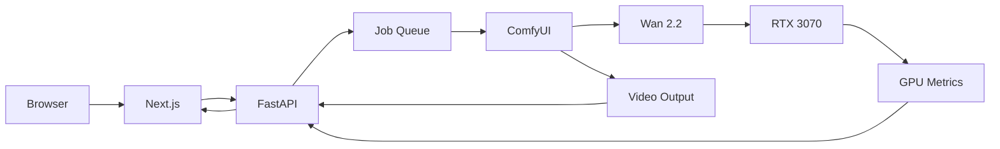

<div align="center">

# Motion Atlas

**Your own AI video generation engine.**

Generate videos with an open-source diffusion model running on your own GPU —
and see what happens during inference.

`Wan 2.2 TI2V 5B` · `ComfyUI` · `RTX 3070 8GB` · `Next.js` · `FastAPI`

</div>

---

Motion Atlas is a self-hosted, portfolio-grade take on Runway / Kling / Luma /
Pika. Same core loop — prompt (or image) in, MP4 out — but the model runs
**locally** and the app is built around **technical visibility**: live inference
stages, per-step progress, GPU telemetry, a real job queue, and full
reproducible metadata for every render.

> **Status:** Milestones 1–3 complete. The full frontend runs today in
> **`DEMO_MODE`** with a simulated inference pipeline — no GPU or ComfyUI
> required. Real ComfyUI + Wan 2.2 integration is Milestones 4–14
> (see [`docs/architecture.md`](docs/architecture.md)).

## Demo

```bash
pnpm install
pnpm --filter @motion-atlas/web dev
# open http://localhost:3000  ·  DEMO_MODE is on by default
```

Every screen works: submit a generation, watch it move through
`queued → preparing → loading_model → encoding_prompt → sampling → decoding → saving → completed`,
see simulated RTX 3070 curves, browse the seeded gallery, open a generation's
full metadata, and download the result (recorded live from the in-browser
synthetic clip).

## Features

| | |
| --- | --- |
| **Text-to-video & image-to-video** | Two modes, one workflow contract. Image uploads are validated for MIME, extension, size and decodability. |
| **Live inference telemetry** | Stage + `current_step / total_steps` + elapsed, streamed over a WebSocket-shaped event channel. Progress is computed from real step counts — never faked. |
| **GPU dashboard** | Utilization, VRAM, temperature, power — sampled every 2s with a rolling ~5-minute history and Recharts graphs. |
| **FIFO job queue** | `MAX_GPU_WORKERS=1`. One generation on the GPU at a time; the rest wait with a visible queue position. |
| **RTX 3070 safety rails** | Resolution / frame / step ceilings enforced client- and server-side. CUDA OOM is caught and surfaced, never fatal. |
| **Reproducible metadata** | Seed, model, resolved params, timings, peak VRAM, `prompt_id` — persisted per run. |
| **Architecture & System pages** | A live pipeline diagram that lights up the active path, plus local diagnostics mirroring `scripts/check-system.mjs`. |

## Architecture



- **The browser never talks to ComfyUI.** FastAPI is the only gateway.
- **Provider seam:** the UI depends on one `GenerationProvider` interface.
  `MockProvider` (demo) and `ApiProvider` (real) are interchangeable via
  `NEXT_PUBLIC_DEMO_MODE` — the frontend never changes.
- Full component-by-component breakdown: [`docs/architecture.md`](docs/architecture.md).

## Repository layout

```
motion-atlas/
  apps/
    web/          Next.js 15 · App Router · Tailwind v4 · shadcn-style UI · Zustand · Recharts · Framer Motion
    api/          FastAPI gateway (skeleton — Milestones 4+)
  comfy/
    workflows/    wan22_t2v.json / wan22_i2v.json  (added in Phase 2, exported from ComfyUI)
  storage/
    uploads/      input images (UUID names)
    generations/  rendered MP4 + metadata.json
  docs/           architecture.md · comfyui-setup.md
  scripts/        check-system.mjs · make-demo-video.mjs
  docker-compose.yml · .env.example
```

## Technology stack

**Frontend** — Next.js (App Router, TS), Tailwind CSS v4, shadcn/ui-style
components on Radix, Framer Motion, Zustand, Recharts.

**Backend** — Python, FastAPI, Pydantic, asyncio, WebSockets, HTTPX, SQLModel /
SQLite.

**AI runtime** — ComfyUI + Wan 2.2 TI2V 5B on NVIDIA CUDA (RTX 3070 8 GB),
low-VRAM / offloading configuration.

## Hardware requirements

| | |
| --- | --- |
| GPU | NVIDIA RTX 3070 (8 GB) or better |
| Driver | CUDA-capable, recent enough for your PyTorch build |
| Disk | ~20 GB for ComfyUI + Wan 2.2 weights |
| OS | Linux or Windows (developed on Windows 10 + WSL-free) |

### RTX 3070 configuration

8 GB is the constraint that shapes every default:

- resolutions capped at **832×480** (720p is not exposed)
- frame counts **49 (short) / 81 (medium)**, hard max **81**
- steps capped at **40**
- **one** generation at a time; extras queue (max **5**)
- ComfyUI launched with `--lowvram --use-split-cross-attention --preview-method none`
- if free VRAM `< GPU_START_VRAM_THRESHOLD_MB`, the worker holds the job queued
- CUDA OOM → job marked `failed` with a readable message; worker stays alive

## ComfyUI + Wan 2.2 setup

Motion Atlas **never downloads models**. Do it once, verify by hand, then let
the app drive it — full walkthrough in
[`docs/comfyui-setup.md`](docs/comfyui-setup.md):

1. Install ComfyUI, place `wan2.2_ti2v_5B`, `wan_2.1_vae`, `umt5_xxl` files.
2. Launch with the low-VRAM flags above.
3. Generate once **manually** in the ComfyUI UI.
4. `Save (API Format)` → `comfy/workflows/wan22_t2v.json` (and `_i2v`).
5. Set `DEMO_MODE=false`, restart the API.

## Environment variables

Copy `.env.example` → `.env` (backend) and `apps/web/.env.example` →
`apps/web/.env.local` (frontend). Key ones:

| Variable | Default | Purpose |
| --- | --- | --- |
| `DEMO_MODE` / `NEXT_PUBLIC_DEMO_MODE` | `true` | Simulated pipeline vs. real ComfyUI |
| `COMFYUI_URL` | `http://127.0.0.1:8188` | ComfyUI API (never exposed publicly) |
| `MAX_GPU_WORKERS` | `1` | Concurrent generations |
| `MAX_QUEUE_SIZE` | `5` | Queued generations |
| `MAX_WIDTH/HEIGHT/FRAMES/STEPS` | `832/480/81/40` | Hard safety ceilings |
| `GPU_START_VRAM_THRESHOLD_MB` | `2000` | Min free VRAM to start a job |
| `PUBLIC_RATE_LIMIT` | `3` | Generations / IP / day when public |

## How it works

**Job queue** — a single `asyncio.Queue` with one worker. A request is
validated, assigned a FIFO position, and only submitted to ComfyUI when the
worker is free and VRAM headroom is sufficient. (Demo mode reproduces this
in-browser.)

**WebSocket progress** — FastAPI connects to ComfyUI's `/ws`, tracks the run by
`prompt_id`, and re-emits normalized events
(`queued · started · progress · gpu_metrics · completed · failed`) on
`WS /api/generations/{job_id}/events`. During `sampling`, `progress =
current_step / total_steps`; other phases are shown as indeterminate.

**GPU metrics** — `nvidia-smi --query-gpu=...` parsed into a typed struct,
served at `GET /api/gpu` and pushed as `gpu_metrics` events during a run.
Missing tooling returns `{ available: false }` — the API never crashes on it.

## Run demo mode

```bash
pnpm install
pnpm --filter @motion-atlas/web dev      # DEMO_MODE on by default
```

## Run real mode (after Phase 2)

```bash
# terminal 1 — ComfyUI on the GPU box
python main.py --lowvram --use-split-cross-attention --preview-method none --port 8188

# terminal 2 — API
cd apps/api && uvicorn app.main:app --port 8000

# terminal 3 — web
NEXT_PUBLIC_DEMO_MODE=false pnpm --filter @motion-atlas/web dev
```

## Security

- ComfyUI (`:8188`) is **never** exposed publicly — FastAPI is the only gateway.
- Uploads: MIME + extension + size + dimension validation, UUID filenames,
  retention sweep, never executed.
- Remote access via Cloudflare Tunnel (or similar) in front of **web/API only**,
  with auth added first.
- Public deployments: per-IP daily rate limit; optional `STORE_PROMPTS=false`.
- Structured logging omits full prompt text by default in production.

## Limitations

- Demo mode numbers are **illustrative, not measured** — clearly labelled everywhere.
- No 720p on the 3070 deployment.
- Single GPU, single worker — throughput is one video at a time by design.
- Cancellation of an in-flight ComfyUI step is best-effort.

## Roadmap

| Phase | |
| --- | --- |
| 1–3 ✅ | Repo, Next.js UI, full `DEMO_MODE` |
| 4–6 | FastAPI, asyncio queue, SQLite persistence |
| 7–8 | GPU monitoring, ComfyUI health |
| 9–11 | Workflow submission, WebSocket tracking, MP4 retrieval |
| 12 | Image-to-video upload → ComfyUI |
| 13–14 | Error handling matrix, rate limiting |
| 15–16 | Architecture/system polish, README + demo GIF |
| 4️⃣ (opt) | Rule-based prompt enhancer |
| 5 (opt) | Visual presets (prompt helpers only) |
| 7 | `VideoInferenceProvider` → remote GPU (RunPod / AWS / Lambda) |

## License

MIT — see [`LICENSE`](LICENSE).
