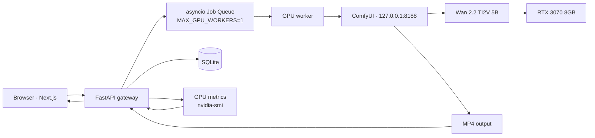

# Motion Atlas — Architecture

Motion Atlas is a self-hosted AI **video** generation platform. A user writes a
prompt (optionally with a seed image), the request is queued, and an open-source
video diffusion model — **Wan 2.2 TI2V 5B** — renders an MP4 on a local
**NVIDIA RTX 3070 (8 GB)** via **ComfyUI**. The web app exposes real-time
progress, GPU telemetry, and full generation metadata.

The guiding constraint is **8 GB of VRAM**: one job at a time, conservative
resolution / frame counts, aggressive model offloading, and a FIFO queue for
everything else.

---

## 1. System overview



### Request path

```
Browser → Next.js → FastAPI → Job Queue → GPU worker → ComfyUI → Wan 2.2 → RTX 3070 → MP4 → Browser
```

### Progress path

```
ComfyUI WebSocket (/ws) → FastAPI → WS /api/generations/{job_id}/events → Browser
```

### GPU monitoring path

```
nvidia-smi → GPU service → GET /api/gpu  ·  and pushed as `gpu_metrics` events during a run
```

---

## 2. Components

| Component            | Tech                                   | Responsibility                                                                 |
| ------------------- | -------------------------------------- | ---------------------------------------------------------------------------- |
| **Web**             | Next.js (App Router), TS, Tailwind, shadcn/ui, Framer Motion, Zustand | UI, generation form, live progress, GPU dashboard, gallery, architecture/system pages. |
| **API**             | FastAPI, Pydantic, asyncio, HTTPX      | The only thing allowed to talk to ComfyUI. Validation, queue, persistence, telemetry, streaming. |
| **Job Queue**       | `asyncio.Queue` + 1 worker            | Guarantees a single concurrent generation. Extra jobs wait FIFO.             |
| **ComfyUI service** | HTTPX + websockets client              | Health, `POST /prompt`, `/ws` tracking, `/history`, output resolution, `/interrupt`. |
| **GPU service**     | `nvidia-smi --query-gpu` (CSV)         | Name, utilization, VRAM used/total, temperature, power. Degrades to `{available:false}`. |
| **DB**              | SQLite via SQLModel                    | `generations` table — the reproducible record of every run.                  |
| **Storage**         | Local filesystem                       | `storage/uploads/` (input images), `storage/generations/` (MP4 + metadata).  |

### Provider abstraction

The frontend never knows whether generation is real or simulated. It talks to a
single `GenerationProvider` interface (`apps/web/lib/provider/types.ts`):

```ts
interface GenerationProvider {
  health(): Promise<HealthStatus>;
  gpu(): Promise<GpuMetrics>;
  createGeneration(req): Promise<{ jobId; status; queuePosition }>;
  getGeneration(jobId): Promise<GenerationJob>;
  listGenerations(): Promise<GenerationJob[]>;
  cancelGeneration(jobId): Promise<void>;
  deleteGeneration(jobId): Promise<void>;
  subscribe(jobId, onEvent): () => void;   // WebSocket-shaped event stream
}
```

| Implementation  | Phase | Notes                                                                    |
| --------------- | ----- | ---------------------------------------------------------------------- |
| `MockProvider`  | 1     | Runs entirely in the browser. Simulates queue, stages, per-step progress, GPU curves, timeline, and a synthetic clip. |
| `ApiProvider`   | 4+    | Same interface over `fetch` + `WebSocket` to FastAPI.                   |

Selected by `NEXT_PUBLIC_DEMO_MODE` in `apps/web/lib/provider/factory.ts`.

The backend mirrors this seam with `VideoInferenceProvider` (Phase 7) so
inference can move to a remote GPU (RunPod / AWS / Lambda) without touching the
web app.

---

## 3. Generation lifecycle

```
request received
   → queued            (FIFO position assigned)
   → preparing         (validate, resolve config, template workflow)
   → loading_model     (ComfyUI loads Wan 2.2 into VRAM — offloaded)
   → encoding_prompt   (T5 text encoder)
   → sampling          (diffusion steps; progress = current_step / total_steps)
   → decoding          (VAE decode latents → frames)
   → saving            (mux frames → MP4)
   → completed | failed | cancelled
```

Progress rule: **never fabricate a percentage.** If ComfyUI only reports steps,
progress is `current_step / total_steps` within the sampling phase; other phases
show indeterminate state.

---

## 4. RTX 3070 safety model

Backend validation rejects unsafe configs *before* they reach ComfyUI:

| Limit                     | Value (initial) |
| ------------------------- | --------------- |
| Max width                 | 832             |
| Max height                | 480             |
| Max frames                | 81              |
| Max steps                 | 40              |
| Concurrent generations    | 1               |
| Max queued generations    | 5               |
| Min free VRAM to start    | 2000 MB         |

- 720p is **not** exposed for this deployment.
- CUDA OOM is caught: job → `failed` with a readable message, worker stays alive,
  cleanup runs, the API never crashes.
- Public deployments add per-IP rate limiting (`PUBLIC_RATE_LIMIT` / day).

---

## 5. Data model (`generations`)

```
job_id · prompt_id · mode · prompt · negative_prompt · seed
width · height · frames · fps · steps · guidance
status · queue_position
created_at · started_at · completed_at · generation_seconds
output_file · peak_vram · average_gpu_utilization · error
```

For public portfolio deployments, prompt text storage can be disabled
(`STORE_PROMPTS=false`).

---

## 6. Deployment stages

1. **LAN mode** — `web :3000`, `api :8000`, `comfyui :8188` all on the RTX 3070 box.
2. **Remote** — expose only `web` (and/or `api`) via Cloudflare Tunnel + auth.
   **Never expose port 8188.**
3. **Cloud GPU** — swap `ComfyUIProvider` → `RemoteComfyUIProvider`.

---

## 7. Build milestones

| # | Milestone | State |
| - | --------- | ----- |
| 1 | Repository structure | ✅ |
| 2 | Next.js UI | ✅ |
| 3 | Demo generation (`DEMO_MODE`) | ✅ |
| 4 | FastAPI | ✅ |
| 5 | Generation queue (`asyncio`, 1 worker) | ✅ |
| 6 | SQLite persistence (SQLModel) | ✅ |
| 7 | GPU monitoring (`nvidia-smi`) | ✅ |
| 8 | ComfyUI health integration | ✅ |
| 9 | ComfyUI workflow submission | ✅ (needs live verification) |
| 10 | WebSocket execution tracking | ✅ (needs live verification) |
| 11 | Video output retrieval | ✅ (needs live verification) |
| 12 | Image-to-video upload | ✅ (upload + templating; live verification) |
| 13 | Error handling (typed, OOM-safe) | ✅ |
| 14 | Rate limiting (opt-in per-IP/day) | ✅ |
| 15 | Architecture / system pages | ✅ |
| 16 | README & demo polish | ✅ |

Milestones 9–12 are coded against ComfyUI's documented HTTP/WebSocket API but
not yet exercised against a live ComfyUI + Wan 2.2 install — that's the Phase 2
task in `docs/comfyui-setup.md`. Everything else runs and is covered by tests
(`apps/api/tests/`) via the `DemoInferenceProvider`.
